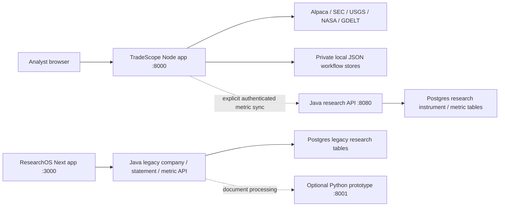
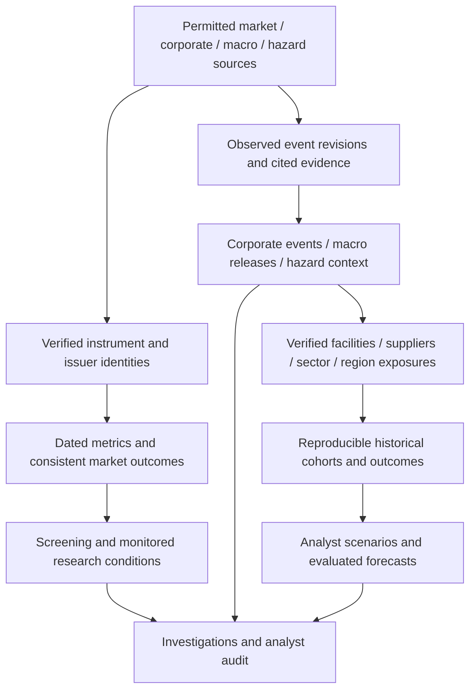

# ResearchOS integration strategy

Decision prepared November 12, 2026 (America/New_York). Baseline audited: TradeScope v0.9 at `7dd781e1a69a99ed6c283dfa796a141d4d5bf5a2`; v0.10 discovery, corporate intelligence and event-archive work is in progress on `feature/tradescope-discovery-corporate-archive`. This document is an implementation decision and migration plan. Proposed milestones below are not claims that those integrations have shipped.

**Decision: share identities and evidence contracts now, move durable workflows into the ResearchOS API next, and consolidate the frontend after API and storage parity.** TradeScope should become the market-intelligence workspace of ResearchOS. Preserve its working local Node workflow throughout that migration. Rewriting every screen before the data boundary is stable would delay useful research and duplicate calculation logic.

## Current system: one repository, several applications

The monorepo already contains the pieces of ResearchOS, but they do not yet operate as one application.

| Component | Implemented and inspected | Integration gap |
|---|---|---|
| TradeScope, `apps/tradescope` | Local source adapters, market streaming, company metrics, screens, alerts, investigations, local monitoring, Atlas and an optional Java snapshot bridge | Most workflow state is local JSON. The browser calls the Node API. It is not a Next.js route or a multi-user service. |
| ResearchOS Java, `apps/api` | Spring Boot, JPA, Flyway, legacy company/statement/scenario services, plus versioned research snapshot endpoints | The new bridge is narrower than shared application state. It does not migrate cases, screens, alerts or monitoring jobs. Bridge-token authentication is not user authentication. |
| ResearchOS Next, `apps/web` | A landing shell and company page consuming legacy company, statement and metric endpoints | No TradeScope workspace is connected. The client contract lacks units, availability, source/version and fiscal provenance. |
| Python, `apps/ml` | Prototype endpoints for document processing, natural-language criteria and similarity | Embeddings are random, natural-language criteria are fixed, and similarity returns hardcoded examples. These paths cannot establish measured research or predictive accuracy. |
| PostgreSQL / pgvector | Legacy tables and separate source-aware metric snapshot tables | The two schemas have distinct semantics. Existing tables are not an immutable event-revision archive or a complete security master. |
| Redis | A local service is declared in Compose | A running Redis container does not establish a durable job queue, scheduler or notification worker. |

Code evidence: [Node server](../apps/tradescope/server.mjs), [research API](../apps/tradescope/lib/research-api.mjs), [Java bridge](../apps/api/src/main/java/com/researchos/api/research/ResearchController.java), [Flyway V1](../apps/api/src/main/resources/db/migration/V1__init_schema.sql), [Flyway V2](../apps/api/src/main/resources/db/migration/V2__research_observation_contract.sql), [Next API client](../apps/web/services/api.ts), [Next company page](../apps/web/app/company/[ticker]/page.tsx), [Python prototype](../apps/ml/main.py), [Compose](../docker-compose.yml).

## Integrate now: this v0.10 increment

The current increment should establish common meanings and demonstrable cross-service compatibility while retaining local operation.

1. **One instrument-registration contract.** Search results are candidates until resolved against a permitted source. Registered instruments carry the source, verification time, exchange/type when actually supplied and a sourced issuer identifier such as SEC CIK when available. Store the provider's instrument identifier separately when supported. Broader research registration must work with company research, watchlists and the optional Java bridge, not just a new dropdown.
2. **One dated observation contract.** Keep the existing 65-definition metric contract, typed scalar/null values, units, source, method, input periods and availability times. The Java receiver and Node adapter must agree on registered non-pilot instruments before claiming broader synchronized coverage.
3. **One normalized event/evidence contract.** Corporate classifications and event revisions should carry source identifiers, original links, cited document sections/passages, classifier version and distinct occurrence, publication and observation times. A generic 8-K title does not establish an earnings event, guidance change or price cause.
4. **Archive observed revisions from this point forward.** The new archive preserves backend observation time and immutable normalized content versions. An old USGS event first retrieved today is a retrospective import. It cannot appear in a replay before this system captured it.
5. **Make local service addresses explicit.** Reserve Node `:8000`, optional Python `:8001`, Java `:8080`, Next `:3000`. This branch makes the legacy Java document origin configurable through `researchos.ml.origin` / `RESEARCHOS_ML_ORIGIN`, defaulting to `http://127.0.0.1:8001`. Starting both Node and Python on port 8000 was a concrete integration conflict.

The proposed local registry bound is 50 registered instruments, with watchlists up to 25 symbols. Per-request scans and monitor targets remain bounded to ten for source/concurrency budgets. Registration expansion does not automatically expand live streaming subscriptions, provider entitlement or market coverage. This is a controlled research universe, not a complete US security master.

### Identity rules that must survive migration

| Identity | Decision |
|---|---|
| `US_EQUITY:<symbol>` | Preserve as a compatibility key for current observations and saved cases. It is a local key, not proof of permanent security identity. |
| Internal instrument ID | Introduce a stable ResearchOS ID through an alias mapping when the security master is persisted centrally. Keep old keys resolvable; do not rewrite historic evidence blindly. |
| SEC CIK | Treat as a sourced issuer identity. One issuer may have multiple share classes; a CIK is not itself a security identifier. |
| Provider asset ID | Keep its namespace and provider. Verify alias/share-class mappings; punctuation replacement alone is not identity resolution. |
| Sector / industry | Preserve scheme and provenance. SEC SIC, informal pilot labels and a licensed sector taxonomy are different classifications. Missing classifications remain unknown. |
| Event / filing | Use namespaced source IDs, accession/provider identifiers and source-specific revision identity. Avoid merging two reports solely because their headlines or timestamps look similar. |

The v0.9 baseline's fixed-symbol coupling is visible in the catalog/source/bridge history. This branch expands [Node bridge validation](../apps/tradescope/lib/research-java.mjs) and [Java research validation](../apps/api/src/main/java/com/researchos/api/research/ResearchContract.java) to accept a dated SEC-directory identity attestation, and [Flyway V3](../apps/api/src/main/resources/db/migration/V3__research_instrument_identity.sql) adds identity provenance to stored instruments. The repository bounds the registry, retains newer verified metadata against legacy writes and rejects silent CIK reassignment.

The trust boundary remains explicit: the Java API validates the attestation contract supplied by the trusted server adapter; it does not independently consult SEC to establish that identity. An arbitrary syntactically valid ticker or browser-supplied CIK is not sufficient verification. Seed compatibility mappings and sourced directory registrations must retain their different provenance. These changes are a bounded bridge, not a full security master, corporate-action history or issuer-exposure graph.

**Completion gate for this increment:** one source-resolved non-pilot issuer can be added to a persisted watchlist, researched, screened, archived when an actual source event is fetched, and synchronized through the optional Java boundary without changing its identity or losing provenance. Unsupported metrics, classifications and source access still remain explicit. The existing ten-symbol monitoring/replay workflows continue to pass their checks.

## Integrate next: durable shared workflows

Begin the central workflow migration immediately after the v0.10 contracts and acceptance flow stabilize. Complete it before shared multi-user operation, unattended hosted monitoring or external notifications. JSON remains a valid single-process local adapter; adding a second writer process to the same files is not the next scaling step.

The Java API should own durable domain records and transactions. Node should keep source transport, ingestion and the existing calculation/rule implementations until contract parity justifies moving a computation. Both the local and central repositories must implement the same versioned domain behavior.

| Domain | Authoritative owner in integrated mode | Important transaction / invariant |
|---|---|---|
| Instruments and aliases | ResearchOS Java API + PostgreSQL | Verified identity registration, alias/effective-date history, source ownership; no arbitrary client CIK or source URL. |
| Event revisions and evidence | ResearchOS Java API + append-only PostgreSQL records | Immutable revision content and actual known-at time; append correction/retraction rather than overwrite evidence. |
| Metric observations | Existing versioned research API + PostgreSQL | Source/method/as-of identity and unavailable semantics. Metric upserts are not a substitute for an event revision archive. |
| Watchlists and screens | ResearchOS Java API + PostgreSQL | Owner/workspace scope, optimistic revisions and versioned condition definitions. |
| Rule evaluations and alerts | ResearchOS Java API + PostgreSQL | Evidence identity, active/recovered/acknowledged lifecycle, cooldown and idempotency in a transaction. |
| Investigations and audit | ResearchOS Java API + PostgreSQL | Case update plus audit event in one transaction; preserve evidence/version references and analyst revisions. |
| Schedules and executions | Database-backed job state + one logical worker lease | Leases, attempt identity, bounded retries and checkpointed progress; duplicate execution must not duplicate alerts. |
| Notification requests | Transactional outbox + configured delivery worker | Commit the alert and delivery intent together; retry delivery idempotently and track outcome. No default external delivery. |

A shared service token continues to authenticate a server adapter. Multi-user mode also needs real user/workspace identities, authorization at each repository operation and audit attribution. Local and hosted modes should report their storage mode clearly. New domain writes must not silently fall back to a separate local file when a configured central write fails.

### Migration sequence and done criteria

| Milestone | Build | Gate before moving on |
|---|---|---|
| M1 — common identities and evidence | This increment's bounded registry/watchlists, corporate event contract, archive schema and Java compatibility | Non-pilot end-to-end flow; duplicate and revised events; no backdated knowledge; legacy behavior preserved. |
| M2 — central evidence and identity repositories | PostgreSQL instrument aliases and immutable event/evidence revisions, plus import/export adapters | Import/restart/cutoff queries preserve IDs, hashes, order and observed timestamps; failed transactions cannot create partial revisions. |
| M3 — shared analyst workflows | Watchlists, screens, alerts, cases and audit behind versioned repositories; user/workspace scope | Local-vs-central contract tests agree; conflicting edits receive revision errors; access checks isolate two users/workspaces. |
| M4 — reliable background execution | Persistent schedules, worker leases, attempts and outbox | Restart/duplicate-worker tests produce one logical alert/delivery; failures retain retry state; monitored work no longer depends on an open local Node process. |
| M5 — unified ResearchOS frontend | Next routes consume the stable same-origin research APIs | Full browser parity for source/readiness, investigations, history/cutoff, themes, alerts and streaming lifecycle; no secret reaches the client. |
| M6 — exposure and evaluated scenarios | Verified effective-dated exposure edges, supported cross-asset outcomes and chronological evaluation datasets | Cohort reproducibility, explicit abstention, held-out tests and baseline comparisons; only supported targets may receive forecast probabilities. |

These are dependency gates, not promised calendar dates or already delivered version numbers. M2/M3 can proceed domain by domain while the existing workstation remains usable. Macro calendars, company event coverage and broader classifications can expand alongside them when their adapters preserve the same identity and timing semantics.

### Safe import and cutover

1. Export the selected local domain with schema version, record IDs, revisions, evidence hashes, source provenance and a capture boundary. Preserve an untouched backup of `.local-data` and the local-only `.env` separately.
2. Import through a versioned, idempotent server importer into a staging namespace/transaction. Validate counts and hashes, references and owner assignment. A second import must not duplicate records or move timestamps.
3. Compare local and central reads against the same fixtures and imported cases. Preserve normalized input evidence; do not recompute old cases using today's facts.
4. Switch one domain's configured repository after parity passes. The old local export becomes read-only backup. Avoid two independent writable authorities for the same alert/case or monitor.
5. Record the cutover boundary and any subsequent central writes. Rollback must export/reconcile those writes first; merely reopening the old file would discard newer work.

The event archive requires a retention policy that is explicit when capacity is reached. A bounded local archive may refuse further ingestion with a visible capacity error; it must not silently evict history while offering reproducible cutoff replay. PostgreSQL migration should preserve that guarantee and make any archival/retention boundary queryable.

## Integrate the frontend after the data contract stabilizes

**Recommendation: use the existing Next application as the eventual ResearchOS shell, and migrate one tested workflow at a time.** Keep the standalone Node entry point for local use until parity passes. A link from the Next shell to the working local workstation is a useful early navigation connection; it is not complete UI or authentication integration.

| Option | Assessment |
|---|---|
| Link to TradeScope during the transition | Small, honest first step. Preserves existing screens and allows backend work to finish without a UI rewrite. |
| Reverse-proxy the existing app under a Next route | Feasible bridge after route/asset/SSE tests. Current root `/api/...` calls and relative assets need deliberate namespace mapping to avoid conflicts with legacy Spring routes. |
| Embed the app in an iframe | Poor default for the shared application. The current Node CSP uses `frame-ancestors 'none'`; changing that alone does not solve routing, focus, identity or session state. |
| Port each workspace to React immediately | High churn before the data boundary is stable. Defer until contract/storage parity, then migrate bounded routes and reuse the calculation contracts. |

The eventual same-origin frontend gateway should expose stable ResearchOS routes and keep provider/service tokens server-side. The [current Next client](../apps/web/services/api.ts) hardcodes `http://localhost:8080/api`; combined/hosted operation needs server configuration and explicit routing. Preserve SSE disconnect, buffering and provider-health behavior when moving the Monitor route behind that gateway.

The proposed shared shell contains Markets, Company Research, Events, Signals/Screens, Investigations and Data Status. Navigation should carry a canonical instrument or investigation identity, not copy unrelated page state. UI migration is done only when users can follow an event into its source revision, a company observation, a rule result and the saved investigation without losing provenance.

### Legacy metric compatibility is a real gate

The [legacy Java calculator](../apps/api/src/main/java/com/researchos/api/service/MetricEngineService.java) stores `GROSS_MARGIN` as a fraction, while the TradeScope catalog defines `financial.grossMarginPct` as a percent. The [Next metric grid](../apps/web/components/MetricsGrid.tsx) currently appends `%` without scaling that legacy value. Reusing the old DTO for the new observations would silently change meaning.

Use an explicit, versioned mapping only where issuer, dates, accounting scope and formula agree. Test the fraction-to-percent conversion and reject missing/ambiguous provenance. Retain legacy tables/DTOs until reads and consumers migrate; deprecate them with parity evidence rather than combining them because their names look similar.

## The larger research product

The product becomes a repeatable evidence path: **what was observed, what was known then, which entities were actually linked, what changed afterward, and what uncertainty remains**.

- Corporate intelligence begins with cited results/agreement/leadership/filing events. Earnings guidance, consensus surprises and options-implied moves require separate supported inputs; a results classification is not a beat/miss determination.
- Macro intelligence needs official release schedules, actual/prior/revised values and vintage timestamps. Consensus is a distinct sourced field. A current revised series cannot be used as if it were known at an old forecast cutoff.
- Disaster research needs official event revisions and footprints plus verified effective-dated facilities, suppliers, ports and issuers. A nearby location or earthquake tsunami flag does not establish damage, business loss or affected securities.
- Ownership and positioning need dedicated Form 4/13F/other parsers with filing delays and amendments. Reported holdings are not live trading activity.
- Forecasting follows reproducible exposure/outcome datasets and evaluation. Define a target and horizon, use chronological holdouts, compare simple baselines and measure calibration/error/abstention. Political/social scenarios require their own evidence and targets.

The [Python prototype](../apps/ml/main.py) and [legacy scenario service](../apps/api/src/main/java/com/researchos/api/service/ScenarioService.java) must stay labeled as prototype/simulation behavior until replaced and evaluated. The scenario service's industry-name coefficient matching is an analyst assumption mechanism, not a measured causal impact model. The [legacy document pipeline](../apps/api/src/main/java/com/researchos/api/service/DocumentService.java) also differs from TradeScope's fixed-source SEC passage reader; unifying their repositories does not make their extraction quality equivalent.

## Decision summary for the current build

Proceed with identity, event revision and corporate evidence compatibility now. Verify the optional Java boundary for newly registered instruments in this release. Then prioritize central identity/archive repositories and analyst workflow migration before hosted monitoring or multiple users. Keep the local app operational, migrate the Next shell after workflow parity, and bring Python into trusted research only after real deterministic implementations and evaluation replace its stubs.

The integrating release's feature status and verification remain authoritative for what actually shipped: [TradeScope feature inventory](../apps/tradescope/docs/FEATURE_STATUS.md), [current requirements](../apps/tradescope/docs/NEXT_RESEARCH_INTELLIGENCE.md), [v0.9 verification](../apps/tradescope/docs/V09_VERIFICATION.md). The referenced consolidated roadmap DOCX was not supplied and is not represented as reviewed here.
